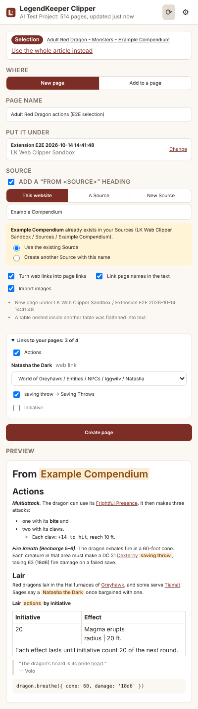
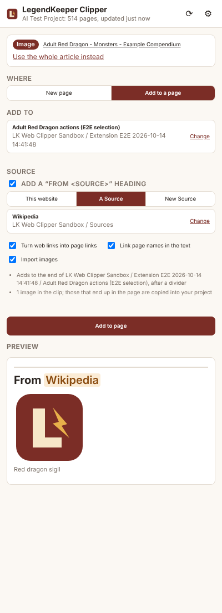

# LK Web Clipper

A lightweight Chrome extension for [LegendKeeper](https://www.legendkeeper.com). Select something on a web page, right-click it and choose **Send to LegendKeeper**. A side panel opens where you choose where the clip goes and which Source it came from, check a preview and import it. The clip arrives as native LegendKeeper content: headings, lists, tables and images included, with a `From <Source>` heading that links the clip to its Source page.

<p>
  
  
</p>

## Status

| Phase | Scope | State |
| --- | --- | --- |
| 1 | Prove the LegendKeeper API integration | **Done.** See [docs/PHASE1.md](docs/PHASE1.md) |
| 2 | Chrome extension: context menu, side panel, capture, preview and import | **Done.** See [docs/PHASE2.md](docs/PHASE2.md) |
| 3 | Fuzzy search, linking page names in the text, ambiguity handling, keeping the page list fresh | **Done.** See [docs/PHASE3.md](docs/PHASE3.md) |
| 4 | Template filling: fill your LegendKeeper templates from a clip, by label matching and optional AI | **Done.** See [docs/PHASE4.md](docs/PHASE4.md) |
| 5 | Complex tables, site-specific rules, Source deduplication | Next |
| 6 | Reliability: retries, duplicate protection, reviewing uncertain links | |

## Install

1. Get the extension: download `lk-web-clipper-<version>.zip` and unzip it, or build it yourself with `npm install && npm run build`, which writes it to `dist/extension`.
2. In Chrome, open `chrome://extensions`, turn on **Developer mode** (top right) and click **Load unpacked**. Choose the unzipped folder (or `dist/extension`).
3. Pin **LegendKeeper Clipper** from the extensions menu if you like. Clicking its icon opens the side panel.
4. In the side panel's Settings, paste an API key and click **Connect**. You create the key in LegendKeeper under **Project Settings → Developers → API Keys** (the project owner needs a paid plan). Add one key per project. If you add more than one, a project picker appears.
5. Check the **Sources page**. If your project has a top-level page called "Sources", it is chosen for you. New Sources are created under this page, and pages under it or tagged `Source` count as Sources.

## Use

- **Selection:** highlight text (with any images, tables and links in it), right-click and choose **Send to LegendKeeper**.
- **Image or link:** right-click it and choose **Send to LegendKeeper**.
- **Whole article:** right-click empty space on the page and choose **Send to LegendKeeper**, or click **Clip this page’s article** in the panel. From a selection, **Use the whole article instead** switches to the full article.

Then in the panel:

- **Where:** pick **New page** (give it a name and choose the page to put it under) or **Add to a page** (choose the page; if it has several tabs, pick one). Search forgives typos and word order (“grayhawk”, “dragon red”). It lists page names first, then aliases, then tags, then pages whose text matches; `#tag` lists every page with that tag. Each result shows where the page sits in your tree.
- **Template** (when **Settings → Templates → Enable template filling** is on): pick one of your LegendKeeper templates, or leave it at “None (clip as usual)”.
  - For a **new page**, the page is made from the template and its fields are filled in from the clip. For **Add to a page**, the template’s main tab is filled in and added below the existing content, after a divider. Child pages of templates are not copied.
  - **Fill with**: **Labels** finds the template’s labels in the clip (“Armor Class 15”, a “Traits” heading, “STR / 8 (-1)”, table rows, “Label: value”), using synonyms such as AC = Armour Class. **AI** asks a language model to pick the parts of the clip for each field. **Labels then AI** asks the AI only about what labels left empty.
  - The **Template fields** list shows each field, its value and where it came from (Label, Synonym, Saved rule, AI…). Untick a value to leave it out, or **Change** it to another part of the clip or a typed value. A field that several labels fit is never guessed. When you pick a value yourself, you can **Remember** it for that website; saved rules are listed in Settings.
  - **Keep unfilled template fields**: on keeps the template’s placeholder text where nothing was found; off removes those fields.
  - The “From <Source>” credit goes at the top of the new page, or at the top of what is added to a page. If the template has its own “From [Source]” heading, the credit goes there instead.
  - Anything in the clip that didn’t go in a field is added at the end, after a divider (or under the template’s own “From [Source]” heading, when only placeholder text sits under it).
  - **Headings that name the page:** a site’s “Bard Class Features” or “As a Level 1 Bard” fills the template’s “[Class] Class Features” or “As a Level 1 Character”. “[Class]” in a Class Template’s headings becomes the page’s name. A table in the template takes the clip’s table with the same column headings. A clip table’s rows the template’s list lacks (“Tool Proficiencies”) are added to the list, with a tick box on the review screen. See [docs/PHASE4.md](docs/PHASE4.md#class-templates-051).
  - **Tags to add** (stat block templates): the creature’s size, type, alignment and challenge rating become tags, e.g. Medium, Humanoid, Any Non-Good Alignment and CR 8. Words in brackets and “Typically” are left out, and a tag your project already has keeps its spelling. Edit or clear them before importing; **Settings → Templates → Tag stat block pages** turns this off.
- **Source:**
  - **Add a “From <Source>” heading** credits the clip with a heading linking to its Source page. Untick it to clip without a credit (and without a Source).
  - **This website** uses the site's own name (e.g. "D&D Beyond"). If a Source with that name already exists, you choose between reusing it and creating another.
  - **A Source** picks one of your existing Sources.
  - **New Source** creates one with the name you give it.

  Each new Source page gets a Backlinks collection, so it lists every page that cites it.
- **Turn web links into page links:** a link whose text is the name of one of your pages becomes a LegendKeeper link to that page.
- **Link page names in the text:** names of your pages written in the clip become LegendKeeper links. It matches whole words only, and the longest name wins, so “Red Dragon” beats “Dragon”. Headings, code and existing links are left alone.
- **Only exact page names** are linked by default, because LegendKeeper shows a page link as the page’s name: linking “attack roll” to the page “Attack Rolls” would change the clip’s words. So “attack roll”, “attack rolls” and an alias like “Weapon Attack” stay as written, and only “Attack Rolls” becomes a link. Untick **Settings → Linking → Link only exact page names** to link aliases, plurals (“Red Dragons”), possessives and, if you also untick case matching, other capitalisations, accepting that LegendKeeper will show them as the page’s name.
- **Links to your pages** lists every proposed link before you import. Untick any you don't want. When a name fits several pages, such as an alias shared by two NPCs, it is left unlinked and shown first, with a menu to pick the right page.
- **Import images:** copies each image into your project's asset library (folder "LK Web Clipper"). If an image can't be copied, the clip keeps a link to it instead.
- Check the **Preview** and click **Create page** or **Add to page**. When you add to a page, the clip goes at the end after a divider. Your existing content is never overwritten: if someone edits the page at the same moment, the clipper re-reads it and tries again.

The panel remembers your last destination and Source for each project, so repeated clipping is a right-click and one click.

In **Settings → Linking** you can link aliases and other wordings too (see above), and choose whether only the first mention of each page in a clip is linked (the default) or every mention.

The page list refreshes itself: when the panel opens or comes back into view after 10 minutes, every 10 minutes while it is open, and when a search turns up a page the list doesn't have. ⟳ refreshes it immediately, and a refresh never resets what you have filled in.

## AI (optional, off by default)

AI assist is only used for template filling, and only if you turn it on in **Settings → Templates**:

- **On-device** (recommended): Chrome’s built-in model (Gemini Nano). It runs on your computer and sends nothing anywhere. It needs Chrome 138 or later and a computer that meets Google’s requirements (22 GB free disk, and a graphics card with more than 4 GB of memory or 16 GB of RAM). **Set up on-device AI** in Settings downloads the model once; `chrome://on-device-internals` shows whether your computer can run it.
- **OpenRouter**: for computers that can’t run the on-device model. Paste your own OpenRouter key; only free models (ids ending in `:free`) are offered or used. This sends the clip’s text to OpenRouter and the model’s provider, so the clipper asks you to confirm before switching it on.

The AI never writes LegendKeeper content. It only says which parts of the clip go in which field (or copies a short value), and you review everything before importing. The clipper checks every answer against the clip's own labels and headings, and leaves an answer unticked, with the reason, when:

- it isn't in the clip (**AI-written**);
- the clip labels it for something else ("Saving Throws DEX +6" offered as Legendary Actions);
- it sits under a different heading, or under a heading that names another field.

**Fill with** offers four choices:

| Choice | What it does |
| --- | --- |
| **Labels** | Label matching only; no AI. |
| **AI** | The AI picks parts of the clip for every field. |
| **Labels then AI** | Labels first, then the AI picks parts of the clip for the fields left. |
| **Labels then AI writes** | Labels first, then the AI fills the fields left and may *write* short fields, reformatting, combining and working out values. |

**Notes about each template** guide the AI in every AI mode. Built-in notes cover the kinds of template in the test project: D&D 5e stat blocks, spells, magic items, classes and subclasses, deities, realms, places and characters. A template uses the first built-in notes that fit its fields (or, failing that, its name). In **Settings → Templates → AI notes for templates** you can:
- edit any template’s notes into your own, or write notes for a template with none; **Remove your notes** goes back to the built-in ones;
- click **Suggest notes with AI**: the AI drafts notes from the template’s fields, its notes so far and the clip open in the panel as an example. The draft is shown for you to check and edit, and saved only when you click **Save these notes**.

When the AI only picks (AI, Labels then AI), it is told to copy values exactly as the clip has them, so the notes tell it where things go rather than how to rewrite them.

In **Labels then AI writes**:
- **What it can't write:** long sections (Traits, Actions, Description…) still take the clip's own paragraphs.
- **Checks on written values:** a written value is ticked only when every number and name in it is in the clip. It must also not leave out part of the clip line it rewrites; if it does, the clip's line is used instead.

The page name is never put in a field. Fields the clip doesn't state but other fields decide are worked out by rules you can edit in **Settings → Templates → Worked-out fields**. The default writes Initiative as the Dexterity modifier and, in brackets, 10 plus it: Dexterity 12 (+1) gives “+1 (11)”. A rule also completes a value the clip only starts (“Initiative +1” becomes “+1 (11)”). See [docs/PHASE4.md](docs/PHASE4.md#keeping-the-ai-honest).

## Where your API key is kept

The key is stored in the extension's own storage (`chrome.storage.local`). The pages you clip can't read it, and the capture script that runs in those pages never sees it. Only the side panel uses it, to talk to LegendKeeper directly. No other server is involved, unless you switch on the OpenRouter AI engine (see above); its key is stored the same way. The extension asks to read all sites so it can capture from any page and copy images from wherever they are hosted.

## Development

Needs Node 22.9 or later.

```sh
npm install
cp .env.example .env      # put a LegendKeeper API key in .env (for the live checks only)
npm test                  # offline unit tests (converter, link resolution, index, search)
npm run typecheck
npm run build             # the extension, into dist/extension (add -- --zip for a zip)
npm run e2e               # loads the built extension in Chromium and clips into your project
npm run phase2:import     # converts and links real web pages, and imports them through the same pipeline
npm run phase4:templates  # fills the project's Statblock and God templates from real clips (AI cases need OPENROUTER_API_KEY)
npm run eval:ai           # scores the AI's fills of saved clips: right, missed, caught by the checks, wrong (needs OPENROUTER_API_KEY; --no-notes to compare without the template notes)
npm run poc               # the Phase 1 API proof of concept
```

The live checks write only under the page **LK Web Clipper Sandbox** and never delete anything.

```
src/lk/          LegendKeeper integration: client, project index, search, Sources, pages, templates, images, errors
src/clip/        HTML → LegendKeeper blocks, link resolution, preview rendering, the import pipeline
src/fill/        Template filling: slots, clip candidates, label matching, AI jobs and engines, composing the page
src/extension/   The Chrome extension: background worker, capture script, side panel
scripts/         Build, end-to-end test and live checks
test/            Unit tests and the HTML fixture
docs/            Phase notes, the Phase 1 output and side-panel screenshots
```
