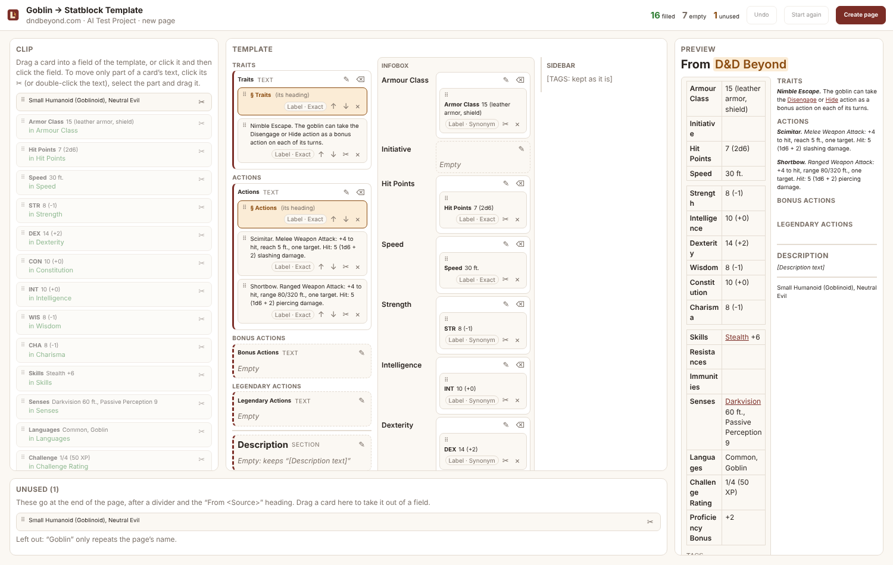

# The mapper (0.7.0)

The mapper replaces the side panel's dropdown review list. It is a page of its own where you fix how a clip goes into a template by dragging parts of the clip into a picture of the template.

  

Everything is still off until you tick **Settings → Templates → Enable template filling**. With it off, the panel works exactly as before, and nothing new is stored.

## Using it

1. Clip something, choose **New page** (or **Add to a page**) and a **Template** in the side panel.
2. The panel shows a short summary, such as **17 filled · 6 empty · 1 unused**, and an **Open mapper** button. Click it. The mapper opens in a new tab next to the page you clipped. Clicking it again goes back to that tab.
3. The mapper has four parts:
   - **Clip** (left): the clip as cards. A labelled value ("Armor Class 15") is one card. A heading or label line is a § card, with the cards under it indented beneath it. Every other paragraph, list, table and image is a card. A card already in a field says which one ("in Armour Class").
   - **Template** (middle): the template laid out like LegendKeeper. It shows tabs across the top, the page with its headings, text fields and infobox rows, and the sidebar down the side. Every place that takes a value is a drop zone. It is labelled with what it takes: short text, text, section, image or links.
   - **Preview** (right): the page as it will be written, updated with every change.
   - **Unused** (bottom): what didn't go in a field. It goes at the end of the page, after a divider and the "From <Source>" heading. Nothing from the clip is ever dropped. The only exception is a line that just repeats the page name (the mapper says so).
   - **Resizing (0.7.1):** drag the dividers between the parts to make the clip, the preview or the Unused tray bigger or smaller, and the one beside the template's sidebar to make the sidebar wider. A divider also moves with the arrow keys once focused, and double-clicking it puts that part back to its default size. **▸** next to "Sidebar" hides the template's sidebar, leaving a narrow **Sidebar** tab (with how many of its fields are filled) to show it again. The mapper remembers the sizes and whether the sidebar is hidden.
4. Click **Create page** (or **Add to page**) in the mapper, or **Import** in the panel. Either way the side panel does the import, so **keep the side panel open**. If it is closed, the mapper says so. Click the extension's icon to open it again; it picks up where it was. Then click Import again.

### Moving cards

- **Drag** a card onto a field. You can drag from the clip, from one field to another, or back to the clip or Unused.
- **Click** a card, then click a field. **Esc** cancels.
- **Keyboard:** Tab to a card, Enter to pick it up, Tab to a field, Enter to put it there.
  - Delete sends a card in a field back to Unused.
  - Alt+↑ / Alt+↓ move it within a section.
  - Ctrl+Z undoes.
- **While you drag or pick up a card**, fields that can't take it are greyed out, and the ones that can are outlined in green:
  - A one-line field takes a short value.
  - An image field takes an image.
  - A links field takes a card with links to your pages.
  - A section or text field takes anything, as several cards you can reorder (drag them, or use ↑ ↓).
- **A § card** brings the cards under it along. Its own heading isn't written, because the template has its own.
- **Part of a card's text:**
  1. Click the card's **✂**, or double-click its text.
  2. Select the part you want.
  3. Drag the selection to a field, or click **Make a card from the selection** and then a field.
  - The rest of the card stays where it was, so nothing is lost.
- **Each field** has ✎ to type a value and ⌫ to clear it. An empty field says whether it keeps the template's placeholder or is removed (the panel's **Keep unfilled template fields**).
- **Start again** goes back to what label matching found.

### Where values came from

Each card in a field has a badge:

- **Label · Exact**, **Label · Synonym** or **Label · Loose**: label matching.
- **Saved rule**: one of your rules for this website.
- **AI**: the AI assist.
- **Worked out**: a worked-out field, such as Initiative from Dexterity.
- **Manual**: you put it there.
- **Typed**: you typed it.

When several clip values fit one field equally well, the field lists them. Click the one you want. When the AI's answer for a field doesn't agree with the clip, the field shows it with the reason, and **Use it anyway** puts it in.

### Saved rules

When you drag a **labelled** value into a field, the field offers **Remember this for <website>: "Proficiency Bonus" goes in "Resistances"**. Ticked, it is saved when you import. Next time, on that website, that label fills that field before any other label matching. Prose has no label, so it can't become a rule, and the option isn't offered for it.

**Settings → Templates → Saved rules** lists every rule. You can change its website, the clip's label or the field (from the template's own fields), or delete it. A rule whose field is no longer in its template, or whose template is gone, is marked and skipped.

## How it works

- **The plan is made as before.** Label matching makes a fill plan, with saved rules first and the AI if switched on. It now also records which parts of the clip each field uses.
- **The plan becomes cards and slots** (`src/fill/mapping.ts`).
- **The mapping is plain data**: field (slot) id → card ids, in order. It also holds each card's badge, typed values, where cards were split, and the rules to remember. An AI step could produce a mapping the same way.
- **A field you never touch keeps exactly the plan's value.** With nothing moved, the page is the same as without the mapper. A unit test checks this for every saved clip. Only the fields you change are built from their cards.
- **Panel and mapper talk through `chrome.storage.session`:**
  - The panel hands the mapper the cards, slots, mapping and template.
  - Each change in the mapper goes back to the panel, which updates its preview and summary.
  - When the panel makes the plan again (you rename the page, the page list refreshes, the AI answers), your changes are carried over.
  - Import requests go from the mapper to the panel. A panel claims each request first, so even two open panels import once. The panel then reports the result to the mapper, including **Page created, but filling failed**, with a link to the page; Try filling again and Delete the new page are in the panel.
- **No outside code.** Drag and drop is Chrome's own, and everything is bundled into the extension.

### Also new

- **Links fields.** A links block, or a collection whose pages are picked by hand, is now a field. It takes the pages the clip links to, by label ("Allies: …") or by dragging. A collection that picks its pages with a filter, like a Source's Backlinks, fills itself and is left alone.
- **Rows label matching adds.** When a clip table fills rows of a template list, the rows the template lacks are added to the list, as before. The mapper says so on that field. If you change that field, those rows go to Unused instead.

## How it was tested

- **Unit tests** (`npm test`, 218 now). They run on the saved Goblin, Assassin, wiki Zombie and Bard clips, plus two new ones: a wiki page with an infobox (`wiki-infobox.html`) and a plain article (`plain-article.html`). They cover:
  - With nothing moved, the page is exactly what label matching makes, and every field rebuilt from its own cards gives the same page.
  - The cards: labelled values, sections, tables with their rows, and images.
  - Moving and reordering, sections bringing their cards, refused drops, clearing and typing, splitting a selection, and that no word of the clip is lost.
  - Ties, unused AI answers, remembered rules (and none for prose), keeping changes when the plan is made again, and links fields.
- **The mapper in Chromium** (`npm run mapper:check`). It covers:
  - dragging between fields, into a section and back to Unused;
  - click-to-place, the keyboard, Undo, typing and clearing;
  - greyed-out fields, splitting a selection and picking from a tie;
  - Import through a stand-in panel;
  - the wiki and plain article clips.
- **The panel and the mapper together** (`npm run panel:check`), against a stand-in for the LegendKeeper API. It goes through:
  - connect, turn on templates, clip the Goblin, open the mapper and move two cards;
  - rename the page in the panel (the changes stay);
  - import from the mapper tab, and read back the page written (one page, the values where they were dragged);
  - the saved rule, edited in Settings;
  - with template filling off, a plain clip as before, with nothing new stored.
- **Not run here:** `npm run e2e`. It is updated for the mapper but needs your API key, so please run it, or try the steps in the README.
